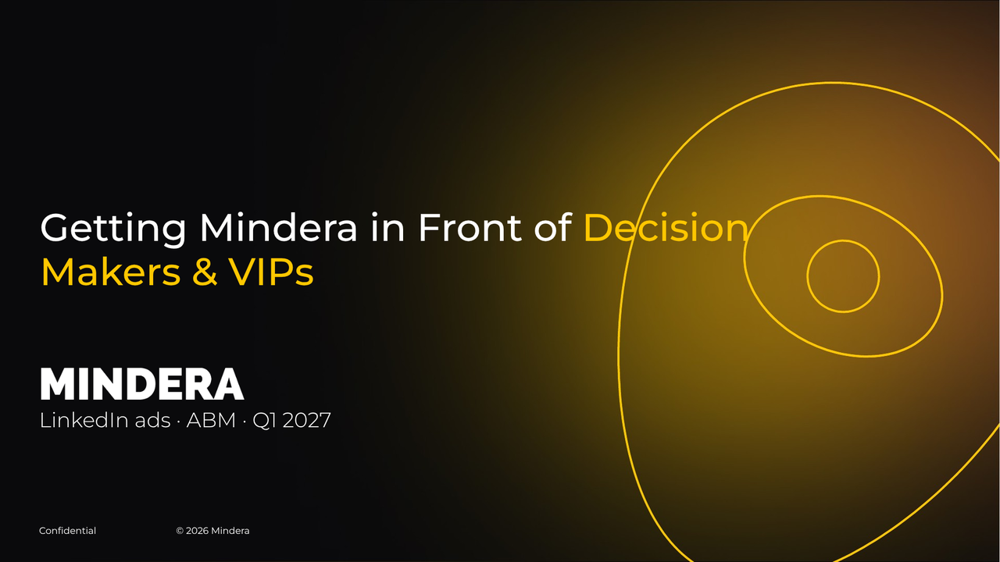
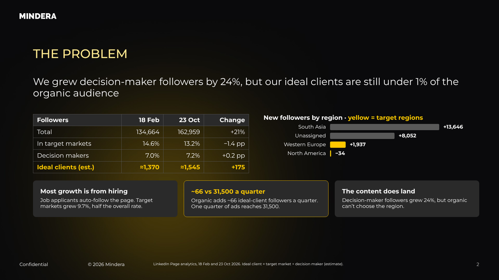
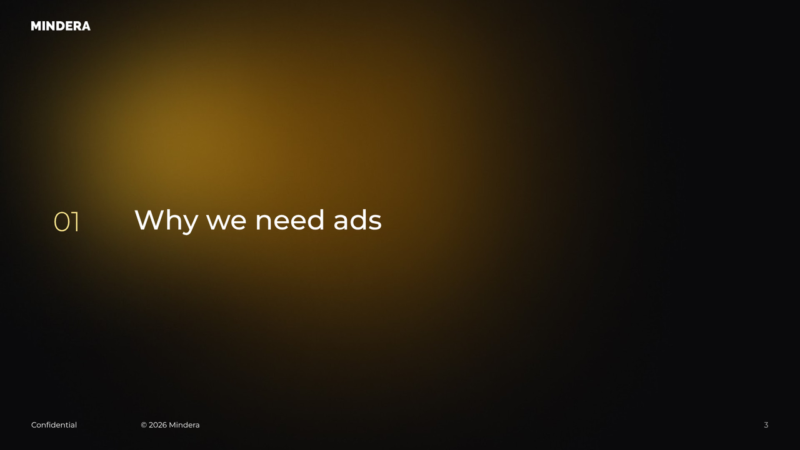

# Slides: the Mindera template, the text hierarchy, and PPTX / Google Slides

Read this when building a Mindera deck or slide, in HTML or in any tool that exports to PowerPoint or Google Slides. It records the Mindera slide template (cover, content and section-divider layouts) and the slide guidelines (text hierarchy, strokes and colours), measured from the template file itself.

These rules are for slide decks only. Web pages and apps follow the general brandbook tokens and fonts in `mindera-theme.css`, which this page doesn't change. `assets/mindera-slides.css` implements the slide rules as classes and applies its font and colour overrides only inside `.mt-slide`, so loading it on a page that also has web UI leaves that UI untouched. `examples/slide-template.html` shows one slide of each layout:

## Canvas: 16:9 widescreen

The template is 13.333 × 7.5 in (12,192,000 × 6,858,000 EMU), PowerPoint's and Google Slides' "Widescreen 16:9". Build slides at **1920 × 1080 px**. On that canvas:

- 1 px = 6,350 EMU, so a position in px maps exactly onto the template's master.
- 1 pt = 2 px, so a 24pt template font is 48px.

Don't build at 1280 × 720 or at 10 × 5.625 in (Google Slides' older default). The positions and type sizes below then no longer match the master, and an export gets rescaled.

## Typeface

Slides use **Montserrat only**, for everything, at these weights: Light (300), Regular (400), Medium (500), SemiBold (600) and Bold (700). The template's own master uses Montserrat, Montserrat Medium and Montserrat Light. PP Neue Machina, the brandbook's web headline face, isn't in the slide template, and a non-Google font falls back to Arial when a deck reaches Google Slides. So inside `.mt-slide`, `mindera-slides.css` points `--mt-font-head` at Montserrat. Web pages keep PP Neue Machina headlines.

## Colours and strokes (slide guidelines)

| Colour | Use |
|---|---|
| `#FFC700` | Highlighting text, illustrations, chart bars. Also a 1px line. |
| `#2A2A2A` | Text box backgrounds (`--mt-surface`). |
| `#FFFFFF` | All text on dark backgrounds. Also a 1px line. |
| `#595959` | 1px lines: table rules, dividers, outlines (`--mt-border`). |
| `#FFE68E` | Slide titles and section numbers, from the template theme's `accent2` (`--mt-title`). |

On Mindera Dark, `mindera-slides.css` sets these values on the tokens inside `.mt-slide` only: `--mt-text` `#FFFFFF`, `--mt-surface` `#2A2A2A`, `--mt-surface2` `#373736`, `--mt-border` `#595959` and `--mt-title` `#FFE68E`. `--mt-muted` `#D9D9D9` and `--mt-muted2` `#A6A6A6` are for incidental chrome only. All of them clear 4.5:1 on `#2A2A2A`. On other themes, slides keep that theme's tokens, and `--mt-title` falls back to `--mt-accent-ink`.

These rules follow from the table:

- **Every line is 1px.** Don't use 4–6px accent bars.
- **Highlight with an outline, not a fill.** A highlighted box is `#2A2A2A` with a 1px `#FFC700` border and a yellow title. A solid yellow box is for illustrations only, such as a mock ad image, and its text is black.
- **Body copy is white.** Don't use grey for body copy. Hierarchy comes from size and weight, not dimmer text.

## Text hierarchy

The template placeholders set the slide chrome, and the guideline sets everything inside the content area.

| Role | pt | px | Weight / case | Token |
|---|---|---|---|---|
| Cover title (template) | 37 | 74 | Medium, title case | `--mt-fs-cover-title` |
| Section divider title and number (template) | 33 | 66 | Medium; number Light in `#FFE68E` | `--mt-fs-divider-title` |
| Slide title (template) | 24 | 48 | Medium, UPPERCASE, `#FFE68E` | `--mt-fs-title` |
| Cover subtitle (template) | 20 | 40 | Light | `--mt-fs-subtitle-cover` |
| Slide headline (template body placeholder) | 19 | 38 | Regular, sentence case, 1.15 spacing | `--mt-fs-headline` |
| Highlighted text / Separator title (guideline) | 17 | 34 | Sentence case / UPPERCASE | `--mt-fs-highlight` |
| Subtitle (guideline) | 11 | 22 | Sentence case | `--mt-fs-subtitle` |
| Body text 01 (guideline): tables, box titles | 12 | 24 | Regular, box titles Bold | `--mt-fs-body-1` |
| Body text 02 (guideline): text in boxes | 10 | 20 | Regular, 1.15 spacing | `--mt-fs-body-2` |
| Footer (template) | 9 | 18 | Regular; page number Light | `--mt-fs-footer` |
| Captions (guideline) | 8 | 16 | Sentence case | `--mt-fs-caption` |
| Small notes (guideline): source lines | 7 | 14 | Sentence case | `--mt-fs-note` |

## Layouts

All positions are in px on the 1920 × 1080 canvas: left, top, width × height.

**Content slide** (template layout "Main large", background `assets/slides/content-bg.jpg`):

| Element | Position | Class |
|---|---|---|
| Logo (white, small) | 62, 40, 165 × 43 | `.mt-slide__logo` |
| Title | 127, 177, width 1717 | `.mt-slide__title` |
| Headline (one or two lines) | 127, 293, width 1717 | `.mt-slide__headline` |
| Content area | 127, 440, 1717 × 530 | `.mt-slide__body` |
| "Confidential" | 75, 1010 | `.mt-slide__confidential` |
| "© 2026 Mindera" | 338, 1010 | `.mt-slide__copyright` |
| Source line | 590, 1010, width 1100 | `.mt-slide__source` |
| Page number (right-aligned) | 1742, 1010, width 102 | `.mt-slide__number` |

The content area holds 530px. A slide that needs more is two slides.

**Cover** (background `assets/slides/cover-bg.jpg`, which includes the yellow line artwork): title at 76, 394, width 1514; large logo at 75, 707, 398 × 61; subtitle at 75, 784, width 1046. It has the footer's "Confidential" and "© 2026 Mindera" but no page number.

**Section divider** (background `assets/slides/divider-bg.jpg`): small logo, number at 127, 494 in Light `#FFE68E`, title at 321, 490, width 1205, and the full footer.

The background images are Mindera Dark artwork. On every other theme, `mindera-slides.css` swaps them for that theme's glows and inverts the white logo on the light themes.

## PPTX and Google Slides compatibility

- **Size:** keep to the 1920 × 1080 canvas above. It is exactly the template's 16:9 widescreen, so an export lands at the right size and nothing is rescaled.
- **Fonts:** use Montserrat only. It is a Google Font, so Google Slides renders it natively. PowerPoint uses it when it's installed or embedded; the template embeds it.
- **Text:** keep all text as real text. Draw charts with boxes and text (`.mt-bars`), not SVG `<text>`. Exporters rasterise SVG and can't load fonts inside it, so SVG labels come out in the wrong font and can't be edited.
- **Backgrounds:** use the background images, not CSS gradients. Gradients don't survive every exporter, and the images are the template's own.
- **Page numbers:** in HTML they are typed text. Renumber after reordering, or let the master's slide-number field take over once the deck is in PowerPoint or Google Slides.
- **Layout tools with padding limits:** some slide editors cap padding. Claude's Slides artifacts, for example, allow at most 256px and silently drop larger values. Don't push content down with a 440px top padding. Use 256px plus a fixed 156px spacer, or pin the content block at `top: 440px`, as `.mt-slide__body` does.
- **PDF:** `mindera-slides.css` sets `@page` to 1920 × 1080 with one slide per page, so printing to PDF keeps the 16:9 shape.
